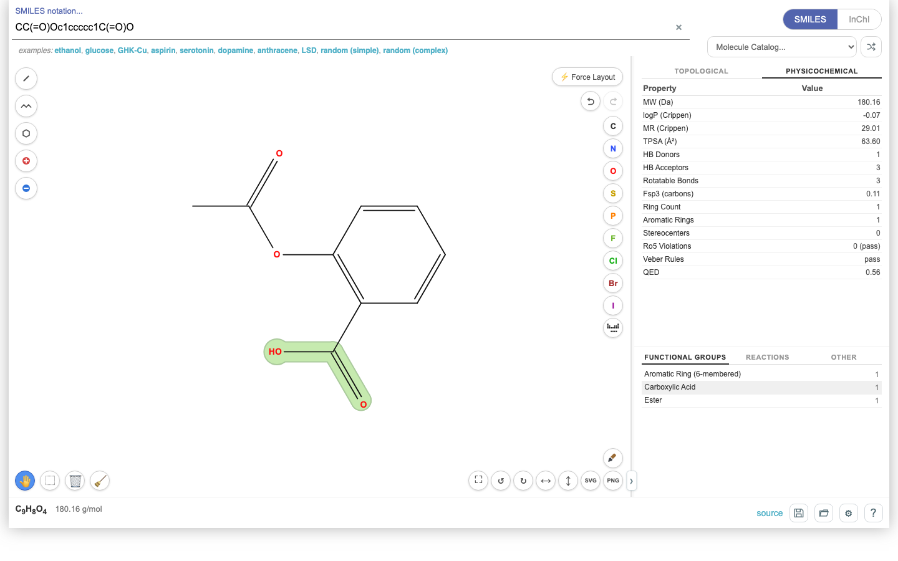
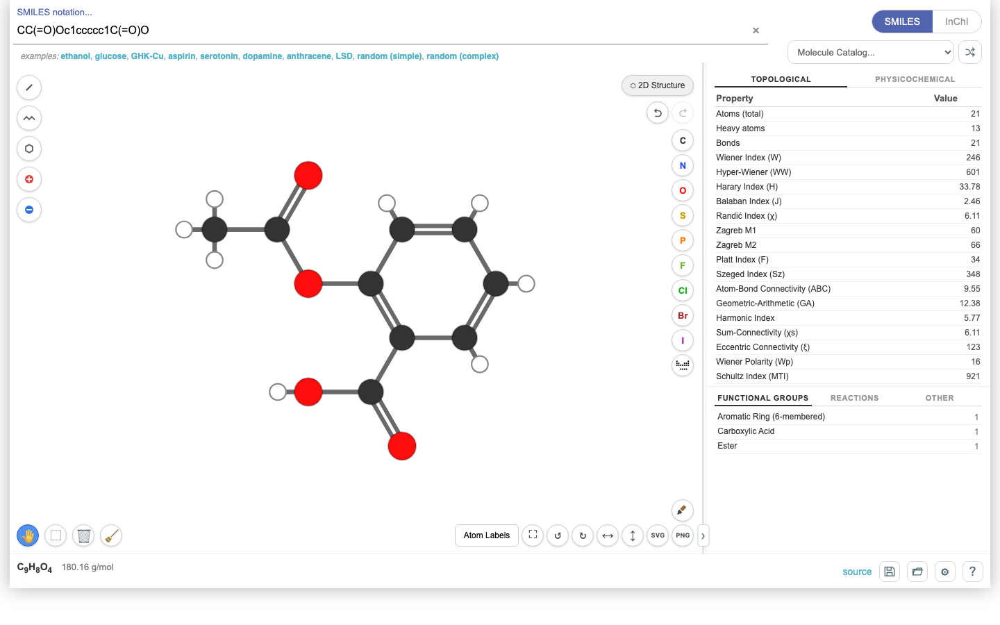
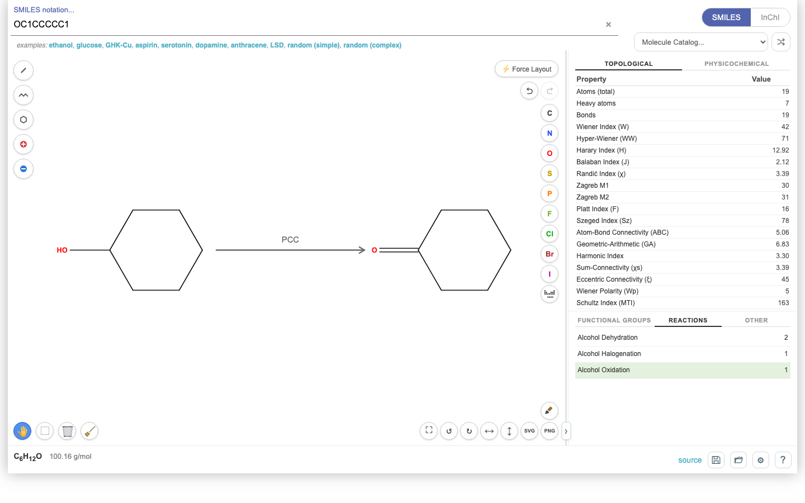

# molecules.js

A JavaScript cheminformatics library with an interactive demo for editing and analyzing molecular structures.

[**Open the demo →**](https://chemplexity.github.io/molecules/index.html)

[Quick start](#quick-start)

[Documentation](docs/README.md)

## Structure editing and analysis



- Load SMILES, InChI, or molecules from the built-in catalog.
- Draw atoms, bonds, chains, and rings; edit charges and stereobonds; undo and redo.
- Inspect topological indices, logP, TPSA, hydrogen bonding, Lipinski rules, and approximate QED.
- Highlight functional groups and supported descriptor contributions.
- Style structures, copy SVG/PNG, and save or reopen molecule JSON.

## Force-directed graphs



Switch between skeletal 2D structures and force-directed graphs. Both views support pan, zoom, rotation, and atom selection.

## Reactions and resonance



Preview SMIRKS reaction templates with reagent and condition annotations. Enumerate resonance contributors and inspect electron-flow arrows. Additional overlays show electronegativity, bond lengths, and atom numbering.

## Library capabilities

- **Formats:** SMILES, canonical SMILES, InChI, JSON, and sequence-to-molecule utilities.
- **Matching:** SMARTS, VF2 subgraph search, aromaticity perception, and Morgan ranking.
- **Transformations:** atom-mapped SMIRKS, reaction templates, and resonance enumeration.
- **2D layout:** generation and refinement for chains, fused/spiro/bridged rings, macrocycles, and organometallic structures; deterministic cleanup by default.
- **Analysis:** graph matrices, topological and spectral descriptors, physicochemical estimates, and valence validation.

## Quick start

Requires **Node.js 24.15+**. Use a checkout of this repository. The npm package named `molecules` is an unrelated project.

```sh
git clone https://github.com/chemplexity/molecules.git
cd molecules
npm install
```

Save this as `example.mjs` in the repository root and run `node example.mjs`:

```js
import { parseSMILES, generateCoords, tpsa, findSMARTS } from './src/index.js';

const aspirin = parseSMILES('CC(=O)Oc1ccccc1C(=O)O');
generateCoords(aspirin);

console.log(tpsa(aspirin)); // 63.6 Ų
console.log([...findSMARTS(aspirin, '[CX3](=O)[OX2H1]')].length); // 1
```

The library uses ESM and declares no runtime npm dependencies. `npm run build` generates shared ESM modules in `es/` and standalone bundles in `dist/`; the example above runs directly from source.

## Run the demo locally

From a checkout of this repository:

```sh
npm install
node tests/e2e/server.mjs
```

Open **http://127.0.0.1:4173**. No build step required; the demo loads D3 7.9.0 from jsDelivr.
